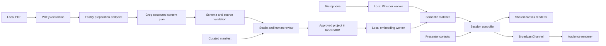

> Current product direction: see [knowledge-base and live canvas amendment](KNOWLEDGE-CANVAS.md) and the canonical [FOLLOW-PRD](../FOLLOW-PRD.md). Older fixed-concept/manual-review requirements below are superseded for the main studio.

# FOLLOW
## Product requirements, visual design, and engineering specification

**Version:** 1.3 — Groq preparation and local live control

**Date:** 17 October 2026

**Team:** four people

**Reference build window:** six hours; rebase milestones to the time actually remaining

**Status:** requirements specification; current implementation and verified gaps are recorded in [APPLICATION-STATUS.md](docs/APPLICATION-STATUS.md)

**Primary deliverable:** a polished, speech-directed presentation on one continuous canvas

**AI provider:** Groq for preparation; local models for live speech and matching

> Usually, speakers follow their slides. With FOLLOW, the presentation follows the speaker.

---

## Contents

1. Product definition and decisions
2. Users, success, and release boundaries
3. End-to-end journeys
4. Visual identity and design tokens
5. Screen-by-screen specification
6. Canvas composition and visual components
7. Motion, accessibility, and responsive behaviour
8. Feature inventory and acceptance criteria
9. Speech, matching, and session behaviour
10. Technical stack and architecture
11. Data contracts and API
12. Groq preparation and source grounding
13. Storage, privacy, security, and cost
14. Curated-PDF fallback
15. Performance and testing
16. Team ownership and implementation plan
17. Demo, risks, and release checklist
18. References and applied skills

---

## 1. Product definition and decisions

### 1.1 The product

FOLLOW converts source material from a PDF into a reviewed collection of concepts, facts, images, and relationships. During a presentation, the speaker's words determine which material appears, how related material is composed, and where the audience's attention moves.

The audience sees **one continuous visual canvas**. There is no slide-page sequence that the speaker must follow. The same source can support different presentations and unexpected questions.

Preparation and performance are separate. Groq proposes the source-grounded content before the talk. During the talk, local speech recognition and semantic matching select from approved content. A deterministic renderer composes the visuals. It does not execute model-generated HTML or invent factual material on stage.

### 1.2 The reversal

Conventional workflow: `write slides → rehearse their sequence → operate the slides while speaking`.

FOLLOW workflow: `prepare knowledge → speak naturally → compose the visual explanation around the speech`.

Single-canvas appearance alone does not establish this reversal. The demo must show non-sequential navigation and at least one speech-directed composition, such as a comparison or progressive process reveal.

### 1.3 Decisions already made

| Decision | Requirement |
| --- | --- |
| Presentation form | One persistent canvas, not automatically changing PowerPoint pages |
| Input | One PDF per project initially |
| Preparation AI | Groq through a server-side API adapter |
| Live AI | Local speech recognition and semantic embeddings |
| Visual quality | A first-class deliverable; polished even in curated mode |
| Generality | Attempt the general PDF pipeline first; time-box unreliable automation |
| Fallback | A manually curated manifest for one specific PDF, using the same renderer |
| Honesty | Distinguish generated/curated content and microphone/typed/replay/manual input |
| Budget | No paid speech or embedding APIs; Groq account-tier quotas and rate limits apply; no provider calls during a cached live talk |
| Platform | Desktop browser first; local demo deployment on one laptop |

### 1.4 What this release does not promise

No arbitrary live graphic generation, internet research, automatic fact verification, universal PDF understanding, meeting transcription service, autonomous narration, or claim of product originality. No authentication, billing, remote collaboration, PowerPoint integration, mobile presenting, or public hosting is required for the hackathon release.

## 2. Users, success, and release boundaries

### 2.1 Users and jobs

**Presenter:** explain prepared material without repeatedly operating presentation controls; recover gracefully when the explanation changes direction.

**Audience:** understand the argument through legible visuals, context, and restrained motion.

**Preparer:** turn source material into an accurate, attractive visual vocabulary; edit it without modifying code in the general workflow.

**Demo operator:** ensure the session can continue when audio, networking, or preparation fails. The operator may be the presenter.

### 2.2 Observable success

- Upload a supported PDF and reach an editable concept map, or explicitly load its curated package.
- Present six to eight concepts in two different orders without editing the source map.
- Match paraphrases, not only exact headings or rehearsed keywords.
- Reveal an approved process step or relationship in response to speech.
- Compose two approved concepts into a comparison when a supported comparison is expressed.
- Remain still on silence, off-topic speech, or an uncertain match.
- Override an incorrect decision immediately and prevent stale audio from undoing that choice.
- Keep presenter controls and transcripts out of the audience window.
- Complete a rehearsed talk using cached content and local live models without Groq calls during the talk.

These are acceptance goals. They are not statements of results already measured.

### 2.3 Release priorities

**P0 — demo release:** the reviewed manifest, polished canvas, concept/process/figure/comparison components, editing essentials, local speech, semantic focus, controlled reveal, one curated PDF package, manual controls, typed rehearsal, audience window, local save/export, and the key failure states.

**P1 — general preparation target:** PDF extraction, Groq generation, validated source references, page crops, general deterministic layout, and regeneration. Start this immediately, but ship the curated content path if it misses the feasibility cutoff. P1 failure must not stop P0.

**P2 — later:** OCR for scanned PDFs, automatic figure boundary detection, numerical chart extraction, arbitrary scene generation, multiple documents, remote audience devices, recorded video export, live multi-speaker support, multilingual matching, full text editor undo history, custom themes, and imported PPTX.

Every feature below is assigned one of these priorities. P2 is explicitly outside the six-hour commitment.

## 3. End-to-end journeys

### 3.1 General preparation journey — P1

1. Open the app. Choose **Upload PDF** or **Open demo project**.
2. Select one PDF. Validate the file, show its name, size, and page count when known.
3. Extract page text locally. Let the user inspect the extraction and limit the pages sent for preparation.
4. Explain that selected text will be sent to Groq. The action **Prepare canvas with Groq** initiates that transmission.
5. Generate a bounded structured plan, validate it, and arrange its content on the canvas.
6. Review source excerpts, correct or remove content, choose figure crops, and approve the project.
7. Download/warm the local models if necessary. Perform a short microphone and matching check.
8. Rehearse in suggest mode, then select Auto or remain in Suggest.
9. Open the audience window, enter fullscreen there, and start listening.
10. Speak. The canvas selects and composes reviewed material. Manual controls remain available.
11. End the session. Stop microphone tracks, preserve the project, and offer to retain or discard session text/events.

### 3.2 Curated preparation journey — P0

1. Open the supplied demo project or upload the exact known PDF.
2. Verify its SHA-256 against the curated package. A filename alone is not sufficient.
3. Load the authored manifest, source references, crops, and layout.
4. Show **Curated content** in the preparation view. Do not show a fake Groq generation progress animation.
5. Review and present with the identical live-control pipeline used by generated projects.

The curated source is now supplied at `demo/source/follow-demo.pdf`, with `demo/manifest.json`. The CLI verifier checks its source hash and quote offsets. The app currently imports that manifest manually; matching an uploaded PDF to the curated package still needs implementation.

### 3.3 Live example

Illustrative material describes FOLLOW itself; it is not a claim about an existing source PDF.

- Speaker discusses presentation friction: focus the problem concept.
- Speaker describes the pipeline: reveal Capture, Understand, Match, and Compose progressively.
- Speaker contrasts fixed slides with a speech-directed canvas: show an approved two-column comparison.
- Speaker answers an offline question: return to the local-runtime architecture detail.
- Speaker returns to the original argument: restore the problem focus without resetting the map.

### 3.4 Recovery journey

If no confident topic is available, hold the current visual. If the microphone fails, show a presenter-only recovery banner and offer reconnect, typed rehearsal, or manual control. None of these paths empties the audience screen. Changing input mode is explicit and recorded in the session status.

## 4. Visual identity and design tokens

### 4.1 Design direction: an editorial presentation studio

The audience should remember the explanation and the way it formed. The application should feel deliberate, quiet, and technically precise. The visual signature is a **scarlet focus trace** that connects speech to the active concept. It is an instrument indicator, not a decorative light show.

Use a near-black stage, graphite controls, warm-white typography, thin connective lines, generous negative space, and one strong accent. Avoid a generic dashboard grid, rainbow nodes, gradient blobs, oversized empty cards, decorative 3D, and repeated floating panels. The canvas is the dominant surface.

Editor chrome is restrained. Audience content has editorial variety: a large statement, a process, a diagram, a figure, or a comparison. Do not render every type as an identical rounded rectangle.

### 4.2 Colour tokens

| Token | Value | Role |
| --- | --- | --- |
| `canvas` | `#0A0A0B` | Main stage and application background |
| `surface` | `#15171B` | Sidebars and input surfaces |
| `surface-raised` | `#1F2328` | Menus, selected inspector sections, dialogs |
| `text-primary` | `#F5F5F2` | Titles and essential copy |
| `text-secondary` | `#B7BDC6` | Body text, context, labels |
| `text-muted` | `#929AA5` | Nonessential metadata; still contrast-tested |
| `line` | `#343940` | Dividers and idle connectors |
| `brand` | `#FF102A` | Primary action, active focus, focus ring |
| `brand-deep` | `#89001E` | Selected background tint and restrained shadow |
| `success` | `#91D7AD` | Approved/ready status, paired with text |
| `warning` | `#E7BB72` | Review required or degraded operation |
| `danger` | `#FF8F9C` | Errors, paired with explicit copy |

Use tokens in component specifications and code. Token definitions are the only source of raw palette values. Do not use the brand colour as small body text or assume white text on scarlet passes contrast: use dark label ink or a tested lighter/outlined alternative where required. Validate actual rendered contrast before shipping. Status never depends on colour alone.

### 4.3 Typography

Self-host Sora and Inter WOFF2 files with their license notices; never require a live font CDN during a presentation. Use system sans-serif fallbacks during loading. JetBrains Mono or the system monospace stack is allowed only for diagnostic values and keyboard hints.

| Style | Font / weight | Size / line height | Use |
| --- | --- | --- | --- |
| Brand | Sora 600 | 22 / 28 px | FOLLOW wordmark |
| App title | Sora 600 | 32 / 40 px | Upload and prepare headings |
| Audience statement | Sora 600 | 56 / 64 px at 1080p | One main idea; maximum two lines |
| Audience heading | Sora 600 | 40 / 48 px | Focused concept title |
| Audience body | Inter 400–500 | 28 / 38 px | Short readable explanations |
| Audience supporting label | Inter 500 | 22 / 30 px | Diagram labels and captions |
| Editor body | Inter 400 | 14 / 21 px | Fields and navigation |
| Small label | Inter 500 | 12 / 16 px | Metadata, never essential projector copy |
| Numeric hero | Sora 600 | 72 / 80 px | Sourced metric only |

Sora titles use `-0.03em` letter spacing; body text uses normal spacing. At 720p, scale composition to preserve essential text at a minimum equivalent of 22 px. Fit less content instead of shrinking a dense layout until unreadable.

### 4.4 Geometry and spacing

- Spacing scale: 4, 8, 12, 16, 24, 32, 48, 64, 96 px.
- Controls: minimum 40 px high on desktop; all touch targets at least 44 × 44 px.
- Radius: 8 px fields, 12 px panels, 16 px dialogs, pill radius only for statuses and segmented controls.
- Borders: 1 px editor dividers, 2 px visible keyboard focus rings with a 3 px gap.
- Shadow: one restrained elevation shadow for transient menus; no repeated glows around every object.
- Content panels use 24 px internal padding; audience modules use 32–48 px.
- Align paired comparison columns and paired panels to equal height. Meaningful diagrams need not be symmetrical.

### 4.5 Iconography and visual assets

Use Lucide icons consistently at 18 or 20 px in chrome, 1.75–2 px stroke, with labels or accessible names. Use authored SVG connectors and actual page crops for content. No emoji as interface icons. No stock imagery unrelated to the PDF. Never invent a research chart, benchmark, testimonial, or image caption to fill space.

## 5. Screen-by-screen specification

### 5.1 Screen A — Start / project entry

**Primary task:** begin with source material or open a known project.

At 1440 × 900: a 64 px header, 48 px outer margins, and a two-column content area with a 40/60 split. The left contains the heading **Your ideas set the pace.**, one short explanation, and a large file-drop target. The right shows an authored miniature canvas preview of the mechanism, explicitly labelled **Example canvas**. This is a product entry screen, not a long marketing landing page.

The drop target accepts click, drag/drop, and keyboard activation. Show **Choose PDF**, accepted limits, **Open demo project**, and **Import project**. Put local recent projects below the main action when present. Do not fabricate recent projects in a new installation.

States: empty, drag-over, validating, valid file selected, unsupported format, oversized file, failed read, and project-restoration failure. Errors stay beside the responsible control. Drag-over changes the outline and copy; no full-page flashing.

### 5.2 Screen B — Source and preparation

**Primary task:** understand the source and approve external processing.

Left: page thumbnails and text extraction status. Centre: the selected PDF page or extraction preview. Right: project title, selected page range, content density (Concise / Standard), detected sections, and **Prepare canvas with Groq**.

Show **Selected document text is sent to Groq for preparation. Live speech stays on this device.** immediately beside the action. A page crop selected later is local unless a future image-understanding feature explicitly requests sending it.

Progress is stage-based: **Reading PDF → Preparing concepts → Checking sources → Arranging canvas**. Show real completed page counts and download byte counts when available. Use an indeterminate stage indicator otherwise; never manufacture a percentage or inferred completion time.

On completion, show **Review your canvas**. On failure, retain extracted material and offer Retry, Edit extracted text, or Open curated demo. Retrying generation does not overwrite an approved project until the replacement is accepted.

### 5.3 Screen C — Canvas studio

**Primary task:** make the explanation accurate and visually coherent before presenting.

Desktop geometry at 1440 px width:

- Header: 64 px, with project title, real save status, Prepare/Rehearse navigation, and **Present**.
- Left concept rail: 232 px, collapsible, independently scrollable.
- Centre: remaining workspace, initially fitted to the complete concept map.
- Right inspector: 312 px when an element is selected; otherwise use the space for the canvas.
- Bottom canvas toolbar: compact, with Overview, zoom, and layout lock. It must not cover focused content.

The concept rail is a list, not slide thumbnails. Each row shows title, visual type, and review status. Clicking selects a concept and its inspector. Source-page and validation warnings are secondary metadata.

Inspector sections:

1. **Content:** title, summary, approved supporting points, and image/crop selection.
2. **Connections:** labelled relationships to other concepts and their evidence.
3. **Speech cues:** aliases and example phrases; these improve matching without requiring exact wording.
4. **Appearance:** visual type and limited emphasis; no full design-tool property panel.
5. **Source:** page number and exact supporting excerpt or crop.

Essential edits: change title/summary, edit supporting points, enable/disable a concept, add/remove a relationship, change approved visual type, rearrange nodes, crop a PDF page, and mark reviewed. Text changes invalidate the affected embeddings and require rebuild before Auto resumes. Retain the prior approved runtime until the revision is ready.

Show **Needs review**, **Reviewed**, **User-authored**, or **Curated** accurately. A source reference existing does not prove a paraphrase is correct. Require human review before calling content approved.

### 5.4 Screen D — Rehearsal and setup

**Primary task:** verify audio, models, and matching before going on stage.

Use a large stage preview with a restrained right-hand setup panel. Show actual model states (Not downloaded / Downloading / Ready / Failed), microphone device, input meter, audience-window connection, reduced-motion choice, and the control policy.

Controls: **Test microphone**, **Warm up models**, **Open audience window**, **Start rehearsal**, and **Start presentation**. Download buttons display known sizes from actual metadata, not hardcoded marketing estimates.

Rehearsal defaults to **Suggest**. A typed phrase box is a first-class diagnostic control labelled **Typed rehearsal — not microphone input**. The same matching and rendering controller handles typed segments and recognised segments. Capture test observations locally: intended concept, predicted concept, delay, and whether the operator accepted it.

Preflight distinguishes blockers from warnings. Missing Groq credentials do not block a cached approved project. Missing local embeddings blocks semantic Auto but allows manual mode. Missing microphone permission blocks microphone input but allows typed rehearsal and manual presentation.

### 5.5 Screen E — Live presenter console

**Primary task:** speak naturally while retaining control.

At 1440 × 900, use a 56 px header, stage preview occupying roughly 72% of the width, and a 320 px control rail. Keep at least 24 px between the preview and controls. The console should look like a compact broadcast control room, not a dense analytics dashboard.

Always visible:

- Current focused concept and a compact topic navigator.
- Listening / Muted / Recovering status with an actual level meter.
- Input label: Microphone, Typed, Replay, or Manual.
- Control policy: Auto, Suggest, or Manual.
- **Pause follow**, **Overview**, **Previous focus**, and **End**.
- Last few transcript segments with provisional text visually distinguished from final text.

The candidate panel shows **Likely topic: Architecture** and a non-probabilistic strength label (Strong / Uncertain), plus **Show** in Suggest mode. Numeric cosine scores belong in a collapsible diagnostic panel, not the primary product flow. Do not display them as confidence percentages.

Default transcript panel shows at most three recent utterances and can be collapsed. Automatic scrolling stops while the presenter inspects older text. Transcript corrections update diagnostics but do not retroactively replay old visual actions.

Manual selection locks automatic changes until **Resume follow**. A visible **Manual hold** chip prevents uncertainty about who is controlling the canvas.

### 5.6 Screen F — Audience stage

**Primary task:** understand the live explanation.

No sidebar, editing handles, microphone status, similarity scores, transcript, source inspector, or private speaker notes. The audience sees the stage content and a small FOLLOW wordmark. A disclosed replay includes a discreet but persistent **Recorded replay** label. A manually controlled demo is introduced accurately; it is not described as autonomous.

Use a 16:9 composition region within any viewport, with safe margins of 5% horizontally and 6% vertically. Letterbox unusual display shapes instead of distorting diagrams. Preload fonts and assets before the stage becomes ready. Fullscreen requires a user gesture in the audience window; opening a popup cannot silently grant fullscreen.

Start on an authored overview. End by returning to the overview or an approved closing statement, not a generic success modal. If presenter communication is lost, preserve the last committed visual and report loss in the console when it reconnects.

### 5.7 Screen G — Session end / local recap

Stop microphone capture first. Show duration, visited concepts, manual corrections, and the active content/input modes. These are local observations, not an invented quality score. Provide **Present again**, **Return to studio**, **Export project**, and **Discard session text**. Saving transcript/events is opt-in; the project itself persists independently.

## 6. Canvas composition and visual components

### 6.1 One world, multiple views

The approved manifest defines stable home positions in a logical world, initially around 3200 × 2000 units for six to eight concepts. Exact size derives from measured content. An overview is a map of relationships, not a filmstrip. The renderer uses the same project and components in studio, preview, and audience modes.

Each concept has a small anchor and approved detail modules. The anchor remains spatially stable. A speech-directed focus reveals details around the anchor and fits the camera to that composition. Comparison view may move the two selected detail groups into a shared frame; their home anchors remain visible in the map. Leaving comparison returns them to their stored positions. Do not recompute the whole graph on every utterance.

P0 supports semantic choices among a finite action vocabulary: `FOCUS`, `REVEAL`, `CONNECT`, `COMPARE`, `OVERVIEW`, `HOLD`. This is dynamic composition of reviewed material, not arbitrary visual code generation.

### 6.2 Visual component grammar

| Component | Composition | Content budget | Live behaviour |
| --- | --- | --- | --- |
| Concept statement | Editorial title with short supporting text; no compulsory card border | Title 64 characters; summary 180 | Focus and highlight |
| Evidence / metric | Large sourced value, unit, context, and label | Value 16 characters; label 80 | Reveal when its approved detail matches |
| Process | 2–5 steps on a clear path with short labels | Label 40 characters per step | Reveal steps as individually matched; no timed autoplay |
| Relationship | Two concept anchors and a labelled connector | Label 48 characters | Draw connection when approved endpoints and relation match |
| Figure | Source page crop with a readable caption | Caption 120 characters | Reveal/fit; preserve aspect ratio |
| Comparison | Two approved concept detail groups, aligned to equal visual weight | At most 3 short points per side | Enter on an unambiguous pair and supported comparison intent |

No metric component without an exact sourced value. Do not imply a causal connector where the document only establishes association. Process order is content order; the audience need not visit every process before exploring another concept.

### 6.3 Visual hierarchy and reveal states

Every item has a state: **not introduced**, **context**, **focused**, or **highlighted detail**. In focused view, show the current title, at most three points, and one principal figure/process. Do not reveal the complete source paragraph.

Unintroduced detail is hidden, not destroyed. Introduced context remains at readable contrast when on screen; small off-focus modules may reduce visual prominence but not become the sole location of essential text. Overview shows concept labels, not all body copy. Return visits preserve previously revealed details unless the presenter explicitly resets rehearsal.

An approved detail can be revealed out of order. A connector may appear only when its endpoints are present. Returning to a process does not replay its entrance animations automatically.

### 6.4 Comparison detection

P0 only composes approved pairs from the manifest. Infer comparison intent through semantic examples plus lightweight language cues such as “compared with” or “whereas.” Require two confidently identified concept mentions in the same recent context. A lone mention of “compare” does not trigger a layout change. If the pair is ambiguous, suggest it or hold; do not invent a comparison.

### 6.5 Camera rules

- Fit the active composition with 12% padding and clamp zoom to legible type sizes.
- Normal focus moves the shortest sensible distance; no spins, fly-throughs, or overshoot.
- Limit automatic camera changes to one committed transition every 2.5 seconds initially.
- Coalesce queued changes: newest valid decision wins; stale camera destinations are discarded.
- Manual Overview and Previous focus act immediately and enter Manual hold.
- Audience viewport dimensions determine framing. Send semantic composition state across windows, not raw presenter pixel transforms.
- Resize refits the current composition once after layout settles; it does not reset the session.

## 7. Motion, accessibility, and responsive behaviour

### 7.1 Motion tokens

| Token | Value | Application |
| --- | --- | --- |
| `duration-press` | 120 ms | Pointer press feedback |
| `duration-fast` | 160 ms | Tooltips, hover and small state changes |
| `duration-ui` | 220 ms | Menus, inspector switching, dialogs |
| `duration-reveal` | 240 ms | Concept detail reveal |
| `duration-focus` | 280 ms | Automatic stage camera and comparison transition |
| `ease-out` | `cubic-bezier(0.23, 1, 0.32, 1)` | Entries and control feedback |
| `ease-in-out` | `cubic-bezier(0.77, 0, 0.175, 1)` | Camera and composition changes |

Use opacity and transforms for motion. No `transition: all`, no `scale(0)`, no animation of layout dimensions during a live focus. Details enter with opacity and at most 8 px travel; staged entry uses 40 ms gaps with a total reveal sequence below 500 ms. Connectors may use a controlled SVG stroke reveal. No perpetual connector pulses or moving particles while the audience reads.

The signature transition: the focus trace selects a concept, its detail settles into place, and the camera frames the resulting explanation. Coordinate these as one interaction. No elastic bounce on the audience stage. A restrained spring can support studio dragging, with a 0.5 s duration and zero bounce.

Keyboard navigation, emergency controls, and manually selected focus changes have no animation delay. Camera transitions triggered automatically remain interruptible. Reduced motion uses instant reframing and a short opacity transition, no panning, zoom animation, or spatial reveal. Provide an explicit presenter toggle in addition to the OS preference.

### 7.2 Accessibility

Use semantic buttons, labelled controls, focus-visible rings, keyboard-reachable nodes, and a linear text outline alternative to the visual map. Decorative connectors are hidden from screen readers; meaningful relationships have text equivalents. Announce current topic changes politely, not each microphone frame or provisional transcript update.

Text and essential controls target WCAG AA contrast. Disabled controls remain identifiable. Error messages identify the cause and recovery action. Do not rely on red/green, hover, motion, or audio alone. Follow mode never moves keyboard focus into a different control.

Dialogs trap focus, close with Escape where safe, and restore focus to their trigger. Ending a session stops microphone capture immediately; no confirmation blocks muting. Destructive project deletion requires confirmation or an undoable local action.

### 7.3 Responsive contract

| Width | Behaviour |
| --- | --- |
| ≥1280 px | Full studio with concept rail and inspector; full presenter console |
| 1024–1279 px | Inspector becomes a drawer; concept rail narrows to 200 px |
| 768–1023 px | Single auxiliary panel at a time; stage preview remains primary; preparation supported, presenting marked best on desktop |
| <768 px | Project inspection and source reading; no promise of live mobile presenting; show clear desktop guidance |

Audience stage supports 1920 × 1080 and 1280 × 720 as release targets. Application chrome uses `100dvh` and independent panel scrolling; never clip an open dialog at browser zoom. At 200% browser zoom, collapse panels rather than hide controls. RTL and multilingual live matching are P2, but avoid fixed text widths that prevent later localisation.

### 7.4 Keyboard controls

| Key | Action |
| --- | --- |
| Space | Pause/resume following; does not silently resume a muted microphone |
| M | Mute/unmute microphone when a microphone session exists |
| O | Overview and Manual hold |
| Left / Right | Previous/next concept in the review order; Manual hold |
| 1–8 | Focus an available concept; Manual hold |
| R | Explicitly resume following after manual hold |
| Escape | Close a dialog or exit the focused UI context; browser owns fullscreen escape |

Shortcuts are disabled in text fields and while a modal consumes them. Controls show labels/tooltips and accessible shortcut hints. An on-screen control exists for every shortcut.

## 8. Feature inventory and acceptance criteria

| ID | Feature | Priority | Acceptance |
| --- | --- | --- | --- |
| F01 | PDF selection and validation | P1 | Accept actual PDF bytes, reject unsupported/encrypted/oversized files with actionable messages |
| F02 | Text extraction and page provenance | P1 | Extract by page; preserve page IDs and exact source text; never silently claim complete extraction |
| F03 | Groq content preparation | P1 | Produce a validated bounded plan or a clear retry/fallback state |
| F04 | Editable concept studio | P0 | Edit content, enabled state, cues, connections, positions, and review state without editing source code |
| F05 | Page crop selection | P1 | Render a PDF page, crop locally, save normalized crop coordinates and page identity |
| F06 | Shared visual renderer | P0 | Generated and curated manifests render through identical components |
| F07 | Local embeddings | P0 | Match non-identical paraphrases and rebuild invalidated vectors after edits |
| F08 | Local microphone transcription | P0 | Explicit start/stop, actual status, no upload of live audio, no repeated overlap-driven actions |
| F09 | Auto / Suggest / Manual | P0 | Policies have distinct behaviour and always-visible presenter labels |
| F10 | Speech-directed visual actions | P0 | Focus, reveal, connect, and compare supported approved material with no fixed topic sequence |
| F11 | Manual recovery | P0 | One action freezes automatic changes; stale results cannot override a manual selection |
| F12 | Audience window and fullscreen | P0 | Same-origin window sync, reconnect/resync, no private console data transmitted |
| F13 | Typed rehearsal | P0 | Same matching pipeline; visibly labelled as typed input |
| F14 | Curated PDF package | P0 | Manifest validated; exact source hash checked when attaching a PDF |
| F15 | Local save and project export | P0 | Reload restores approved content; imported projects validate before use |
| F16 | Session recap | P0 | Actual visited concepts, mode, and corrections; transcript retention opt-in |
| F17 | Labelled replay | P0 | Operator can play a saved event fixture as a disclosed fallback; never presented as live AI |
| F18 | Preflight and warm-up | P0 | Detect missing assets/models/audio permission and give a working recovery path |
| F19 | OCR, automatic charts, arbitrary diagrams | P2 | Not required for hackathon release |
| F20 | Cloud collaboration and mobile controller | P2 | Not required for hackathon release |
| F21 | Video recording and PPTX export | P2 | Project JSON export is the P0 portable artifact |

## 9. Speech, matching, and session behaviour

### 9.1 Audio pipeline

Capture only after a user gesture with `getUserMedia`. Use Web Audio/AudioWorklet to obtain PCM, resample to the speech model's required rate (16 kHz for the proposed Whisper model), and send bounded chunks to a worker. Start testing with 3–4 second chunks and approximately 0.5 second overlap. These are tuning defaults, not latency guarantees.

A cheap local silence gate prevents unnecessary transcription; it is not a speaker-identity detector. Reject empty/near-silent segments. Distinguish provisional text from finalized text. Deduplicate overlap by token/time alignment before sending finalized text to the matcher. Do not run another transcription job for every animation frame.

The single-speaker prototype cannot reliably distinguish the presenter from nearby conversation. Use a close microphone, Pause follow during questions if necessary, and resume explicitly. Do not claim speaker diarisation.

Bound the inference queue to one executing chunk plus the newest pending chunk. Under load, show **Catching up**; do not replay a growing backlog of obsolete topic changes. Preserve a monotonically increasing sequence number and session epoch on every result. Discard results from an old session, prior model revision, muted epoch, or manual override.

### 9.2 Semantic matching

Precompute normalized embeddings for each enabled concept's title, summary, aliases, and curated example phrases. Compute embeddings for a rolling recent-speech window of roughly 12–24 words. Use cosine similarity; start with a prototype matcher that aggregates the best two example scores per concept. Compare against a keyword-only baseline in rehearsal.

Select the top concept and inspect its margin over the runner-up. Starting calibration parameters can be top score 0.45, runner-up margin 0.08, and two consecutive eligible matches for a topic change. These values must be calibrated on the actual model, PDF, and paraphrase set. They are not universal confidence levels or probabilities.

Apply hysteresis: retaining the active topic needs less evidence than changing to another topic. A match to the active topic can reveal a detail without moving the camera. Silence, generic filler, and out-of-scope statements produce HOLD. Do not default to “next concept” when uncertain.

Detail matching uses approved process-step and evidence labels. For a comparison, both endpoints must be resolved within the recent context. CONNECT only references an approved relationship. No new causal statements or factual text are created during live inference.

### 9.3 Independent states

Keep these separate rather than hiding everything in a single `isListening` boolean:

- Lifecycle: `idle | preflight | running | ended | error`.
- Input: `microphone | typed | replay | manual`.
- Follow policy: `auto | suggest | manual`.
- Capture state: `off | requesting | active | muted | unavailable`.
- Model state per model: `absent | downloading | warming | ready | failed`.
- Override: `none | manualHold`.

In Auto, a valid stable candidate commits an action. In Suggest, it updates a candidate preview until the presenter accepts it. In Manual, speech may be disabled; manual actions are authoritative. Pause follow stops automatic decisions while optionally leaving transcription active, with clear status. Mute stops capture and invalidates pending audio; unmute never executes previously buffered speech.

Manual focus invalidates pending decisions, clears candidate history, and enters manual hold. Resume follow clears old speech context and starts a fresh decision window. Switching from Suggest to Auto also clears old candidates.

### 9.4 Audience synchronisation

Use `BroadcastChannel` between same-origin tabs/windows on the same browser. The presenter is authoritative. Messages carry project ID, session ID, manifest revision, sequence number, semantic composition, and motion policy. An audience window announces readiness and requests the latest snapshot; it ignores stale sequences and refuses mismatched project revisions.

Send semantic state, not transcript, notes, tokens, or the Groq key. Both windows load approved assets from local storage. Audience refresh requests a fresh snapshot. The presenter shows connection status from heartbeats. A blocked popup yields an explicit **Open audience window** retry; single-window fullscreen is the fallback. Remote devices and cross-origin syncing are P2.

## 10. Technical stack and architecture

### 10.1 Selected stack

| Layer | Choice | Reason / boundary |
| --- | --- | --- |
| Language | TypeScript, strict mode | Shared contracts across UI, workers, and server |
| Runtime | Node.js 22 LTS; verify package engine compatibility at setup | Stable team baseline; existing host runtime need not be overwritten |
| Package management | npm workspaces, one committed lockfile | Reproducible installs without separate tool setup |
| Frontend | React 19 + Vite | Fast local iteration; no SSR requirement |
| Styling | Tailwind CSS 4 + CSS custom-property tokens | Fast layout with one design token source |
| Canvas | `@xyflow/react` (React Flow), custom nodes/edges | Pan/zoom, node selection, connectors, shared render path |
| Initial layout | Small deterministic layout function | Six to eight concepts do not justify a graph-layout service |
| UI state | Zustand | Project editing and session state; separate stores |
| UI primitives | Radix Dialog/Tooltip/Popover/Select | Keyboard and focus behaviour without hand-built modal semantics |
| Icons | `lucide-react` | Consistent SVG icon system |
| Motion | CSS transitions + Web Animations API; React Flow viewport API | No extra animation framework required |
| PDF | `pdfjs-dist`, bundled PDF worker | Local page text, rendering, and manual figure crops |
| Local inference | `@huggingface/transformers` in Web Workers | Browser speech recognition and embeddings |
| Speech candidate | `Xenova/whisper-tiny.en` | Small English model; measure actual device latency first |
| Embedding candidate | `Xenova/all-MiniLM-L6-v2` | Compact sentence embeddings; use normalized mean pooling as specified by the model |
| Inference backend | WebGPU when supported/tested; WASM fallback | Detect capability; do not silently promise equal performance |
| Backend | Fastify + native `fetch` | One small server-side Groq adapter; no Python service required |
| Validation | Zod + generated JSON Schema | Validate provider output, manifests, imports, requests, and events |
| Groq endpoint | `https://api.groq.com/openai/v1/chat/completions` | Matches the existing server-side smoke test; see R1/R2 |
| Groq model | `GROQ_MODEL` environment configuration; initial candidate `openai/gpt-oss-120b` | Smoke-test account access and structured output; record actual model used |
| Local persistence | IndexedDB through `idb` | Documents, manifests, crops, and local project data |
| Window transport | Browser `BroadcastChannel` | Local presenter/audience synchronisation |
| Unit / integration tests | Vitest + Testing Library; `fast-check` for state invariants | Core matching/controller correctness |
| Browser tests | Playwright | Upload, editing, window sync, recovery, and viewport checks |
| Build checks | TypeScript + ESLint + production build | Required before demo freeze |
| Deployment | Local Fastify serving Vite production assets | Same origin, no public deployment dependency |

Package versions must be resolved together, checked for compatibility, and locked during implementation. Do not copy unverified “latest” versions into the repository or upgrade during demo freeze. Pin downloaded model revisions after the first working run, record their licenses, and bundle local WASM/model/font paths for the offline demo.

### 10.2 Component architecture



### 10.3 Suggested repository

```text
apps/
  web/src/
    screens/              # start, source, studio, rehearsal, presenter, audience, recap
    components/           # controls, inspector, transcript, statuses
    canvas/               # renderer, custom nodes, edges, composition, camera
    workers/              # speech and embeddings; no React dependencies
    audio/                # capture, resampling, silence gate, overlap alignment
    pdf/                  # extraction, page rendering, crop coordinates
    matching/             # scoring, stability, phrase/intent recognition
    state/                # project store, session store, controller
    persistence/          # IndexedDB and validated project import/export
    styles/               # tokens, typography, motion, responsive rules
  api/src/
    routes/               # health, prepare, cancel, status
    providers/            # Groq adapter
    generation/           # schema, prompts, source checks, limits
packages/
  shared/src/             # schemas, types, event contracts, reducers
demo/
  source/                 # actual selected PDF and rights/source note
  manifest.json
  assets/
  phrases.json            # paraphrases, distractors, expected matches
  replay.json             # disclosed event replay
tests/
  unit/
  integration/
  e2e/
```

Keep sample manifests separate from an actual presentation package. Do not claim that a selected PDF or measured performance exists until supplied and tested.

## 11. Data contracts and API

### 11.1 Domain model

The following is an implementation contract sketch; complete runtime schemas are required before integration.

```ts
type SourceRef = {
  page: number;                // 1-based page number
  quote: string;               // exact supporting text, checked against extraction
  start: number;               // offset in the normalized page text
  end: number;
};

type VisualType = 'concept' | 'metric' | 'process' | 'figure' | 'comparison';

type VisualPayload =
  | { type: 'concept' }
  | { type: 'metric'; value: string; unit: string | null;
      label: string; valueSource: SourceRef }
  | { type: 'process'; stepDetailIds: string[] }
  | { type: 'figure'; assetId: string; caption: string }
  | { type: 'comparison'; leftId: string; rightId: string;
      relationshipId: string };

type Concept = {
  id: string;
  title: string;
  summary: string;
  aliases: string[];
  speechExamples: string[];
  visual: VisualPayload;
  details: Array<{
    id: string;
    text: string;
    sources: SourceRef[];
    origin: 'source' | 'user';
  }>;
  sources: SourceRef[];
  assetIds: string[];
  enabled: boolean;
  review: 'needs-review' | 'reviewed';
  position: { x: number; y: number };
};

type Relationship = {
  id: string;
  from: string;
  to: string;
  label: string;
  kind: 'sequence' | 'comparison' | 'association' | 'causal';
  sources: SourceRef[];
  approved: boolean;
};

type Asset = {
  id: string;
  kind: 'page-crop' | 'image';
  blobKey: string;
  page: number | null;
  crop: { x: number; y: number; width: number; height: number } | null;
  alt: string;
  width: number;
  height: number;
};

type Project = {
  schemaVersion: 1;
  id: string;
  revision: number;
  title: string;
  source: { name: string; sha256: string; pages: number };
  preparation: {
    mode: 'groq' | 'curated';
    model: string | null;
    promptVersion: string;
    preparedAt: string;
  };
  concepts: Concept[];
  relationships: Relationship[];
  assets: Asset[];
  approvedRevision: number | null;
};

type CanvasAction =
  | { type: 'FOCUS'; conceptId: string }
  | { type: 'REVEAL'; conceptId: string; detailId: string }
  | { type: 'CONNECT'; relationshipId: string }
  | { type: 'COMPARE'; leftId: string; rightId: string }
  | { type: 'OVERVIEW' }
  | { type: 'HOLD' };
```

Implement `VisualPayload` as a discriminated runtime schema: process steps must reference this concept's existing detail IDs; figure assets must exist; comparison endpoints must be distinct enabled concept IDs linked by the approved relationship. A metric's value source must pass quotation validation. Geometry is deterministic renderer output, not an unrestricted model instruction. The runtime schemas additionally enforce the content budgets in section 6.2.

Embedding cache keys include project revision, model ID/revision, pooling configuration, and a hash of embedded text. Session state contains focused IDs, revealed IDs, comparison pair, action history of IDs, input/policy, sequence, epoch, and timestamps. Raw audio is not part of the persistent project.

### 11.2 API endpoints

| Endpoint | Request / response | Behaviour |
| --- | --- | --- |
| `GET /api/health` | Ready state and configured provider/model names, never secrets | Preflight capability check |
| `POST /api/prepare` | Validated page-text objects, source hash, density; returns `jobId` | Explicit user action; one active generation per local demo server |
| `GET /api/prepare/:jobId` | Stage, completion/error, validated plan when ready | Poll at a bounded interval; actual stages only |
| `DELETE /api/prepare/:jobId` | Cancellation result | Abort active upstream request where possible; suppress late results |

Initial PDF limit: 20 MB and 20 selected pages, with a maximum 80,000 extracted characters in one preparation job. Treat these as prototype limits, not the Groq model's context limits. Explain truncation and page selection; never silently discard middle pages. Initial generated plan limit: eight concepts, five details each, twelve relationships.

Use a 90-second provider deadline and a visible timeout recovery state. Retry transport/429/5xx failures at most once within the job deadline when instructed by the adapter policy; do not retry authentication or exhausted-allowance errors. A schema/content repair may use one separate bounded repair request. Every retry/repair is recorded and consumes request/token allowance. Duplicate submissions reuse the active local job where safe. Cancellation cannot promise reversal of upstream usage already consumed.

Error envelope: `{ code, message, retryable, requestId }`. Codes include `INVALID_SOURCE`, `SOURCE_TOO_LARGE`, `PROVIDER_AUTH`, `PROVIDER_QUOTA`, `PROVIDER_RATE_LIMIT`, `PREP_TIMEOUT`, `INVALID_PLAN`, and `CANCELLED`. Never return provider stack traces or credentials to the browser.

### 11.3 Groq adapter

Use server-side `fetch` to `https://api.groq.com/openai/v1/chat/completions`, authenticated with `GROQ_API_KEY`. Match `apps/api/scripts/smoke-groq.ts`. Configure `GROQ_MODEL`; the initial candidate is `openai/gpt-oss-120b`. This is a preparation provider; live speech and embeddings remain local.

```ts
const request = {
  model: process.env.GROQ_MODEL,
  messages: [
    { role: 'system', content: preparationInstructions },
    { role: 'user', content: pageLabelledSource },
  ],
  response_format: {
    type: 'json_schema',
    json_schema: {
      name: 'follow_prepared_plan',
      strict: true,
      schema: preparedPlanJsonSchema,
    },
  },
  max_completion_tokens: 6000,
};
```

Use a strict-compatible schema: list every property in `required`, set `additionalProperties: false` on every object, and express nullable fields explicitly. Parse `choices[0].message.content` as JSON; reject missing content, unsuccessful completion, invalid plans, and unsupported claims. The adapter owns timeout, bounded retries, usage and error mapping. Only a validated `PreparedPlan` reaches the app; schema compliance is not source verification. No external tools or executable generated visuals are enabled.

The smoke-test script exists, but a real authenticated request has not been verified in this workspace. Run `npm run smoke:groq --prefix apps/api` after configuring the local server environment. See [Groq structured outputs](https://console.groq.com/docs/structured-outputs).

### 11.4 Environment

```dotenv
GROQ_API_KEY=                         # server only; never VITE_ prefixed
GROQ_MODEL=openai/gpt-oss-120b                   # verify access; record actual tested model
API_HOST=127.0.0.1
API_PORT=8787
WEB_ORIGIN=http://localhost:5173
PREP_TIMEOUT_MS=90000
MAX_SOURCE_CHARS=80000
MAX_PREP_JOBS_PER_SESSION=3
```

Provide `.env.example` with blank credentials and ignore real environment files. Frontend configuration contains only nonsecret asset paths and feature flags. Do not ask anyone to paste API keys into the presentation or a chat transcript.

## 12. Groq preparation and source grounding

### 12.1 Extraction

Use PDF.js page text items, position/font metadata where available, and page boundaries. Reconstruct reading order conservatively. Preview extraction for multi-column or complex pages. If text is absent, offer a different PDF, pasted source text, or curated content; OCR is P2. Password-protected/encrypted files receive a specific unsupported-file message.

Figures in P1 are **manual page crops**. The page renderer preserves visual fidelity without depending on extracting individual embedded image objects or reconstructing vector charts. An automatically suggested figure can refer to a page; the user chooses its crop. Do not invent an automated figure-understanding capability in the demo.

### 12.2 Prompt contract

Supply a versioned system instruction and page-labelled source text. Treat document contents as untrusted reference data, not instructions to the application. Request concise concepts, exact supporting quotations, labelled relationships, aliases, and semantically varied speech examples. Bound content length and allowed visual types. Request an empty list where evidence is absent, not fabricated filler.

Groq does not choose arbitrary JavaScript, CSS, remote URLs, or executable diagram code. The renderer selects layout from allowed component types. The model's schema compliance does not establish factual correctness.

### 12.3 Validation

Validate structure with Zod, then validate semantics in code:

- Unique IDs and existing relationship endpoints.
- Limits on concept/detail counts and text lengths.
- Source pages within the selected document range.
- Exact quotes found in normalized page text; resolve offsets server-side.
- No unknown asset IDs, unsupported types, or unsafe links.
- No metric lacking source value/context.
- Causal relationships explicitly flagged for human review.

Mark unsupported claims as needing review or reject them. Surface warnings in the source inspector. The human approval action is required before entering speech-driven Auto. User-authored additions are labelled and never assigned fictitious source quotations.

### 12.4 Content edits and regeneration

Autosave valid edits locally after 500 ms idle, with explicit save errors. A generation revision does not replace the current approved project until accepted. Regeneration replaces a draft section or complete draft only through a clear action; preserve the last approved revision. During presentation, structural edits are locked; end or return to rehearsal to rebuild embeddings and approve a revision.

## 13. Storage, privacy, security, and cost

### 13.1 Data lifecycle

PDF bytes, page text, crops, approved manifests, and revisions are stored in local IndexedDB. Groq preparation transmits only the selected page text and necessary project settings to the server/provider. Raw audio and live transcripts are not transmitted to Groq. API job bodies/results are held in memory, bounded, and discarded after completion/cancellation with a short expiration; no production database is required.

Local transcripts and event logs default to session memory. Opt-in export can retain them, with clear deletion. **Delete project** removes its PDF, text, assets, manifest, embeddings, and session artifacts; shared model caches are a separate setting. Warn when browser storage fails or is unavailable; allow export without pretending a save succeeded.

Portable export is one versioned `.follow.json` bundle containing the project manifest, normalized page text, each referenced asset's MIME type and base64 bytes, and optionally the source PDF bytes. Local IndexedDB keys alone are not portable. On import, validate the bundle and byte limits, rehydrate asset blobs to new local keys, verify the PDF hash when included, and regenerate embeddings if their model/text hashes differ. If the PDF is excluded, presentation still works from bundled content/crops, while full-page source viewing prompts for the matching original PDF. Never export the API key or raw audio. Initial imported/exported bundle limit is 50 MB to keep base64 processing bounded.

This is not a fully offline preparation system. **Offline presentation** means the approved project, fonts, code, models, and runtime assets have been downloaded and tested on the demo laptop. Serving from localhost still uses a local process; internet access is unnecessary only after those prerequisites are met.

### 13.2 Security and deployment boundary

Bind the demo backend to loopback. Use a Vite development proxy or serve built assets from Fastify for one origin. Restrict accepted origins, validate content type and request size, bound jobs, sanitize text, disallow generated executable markup, and allow only local asset references. Do not execute PDF embedded scripts or model-provided code. Logs contain IDs, timings, errors, and usage counts—not raw documents, audio, keys, or full prompts by default.

Public deployment is a separate decision. An unauthenticated publicly accessible preparation endpoint would expose the team's API budget. Add authentication, quotas, transport security, and deployment-specific secret handling before any public release. This PRD does not authorise deploying the app.

### 13.3 Cost controls

The user selected Groq. Check the account's tier, remaining allowance and rate limits before generation. Use the available free tier where applicable; never promise unlimited requests or automatic paid fallback. Cache approved plans by source hash, selected pages, settings, model, prompt version, and schema version. Require explicit regeneration, cap jobs, bound output, and avoid sending every utterance to Groq.

Keep usage counters and model information in diagnostics. Estimate cost only from observed token usage and verified current rates; do not invent a dollar budget from absent account information. No hosted vector database, paid STT, or paid embedding API is required.

## 14. Curated-PDF fallback

### 14.1 What is authored

The team may manually prepare concept text, source references, visual types, figure crops, positions, relationships, and varied speech examples for one actual PDF. Store this as the same versioned `Project` schema used by the general pipeline.

The live core remains real: microphone capture, transcription, semantic matching, stability rules, action controller, composition, audience sync, and manual override. Preserve non-sequential behaviour; a curated manifest must not reduce the demo to a hidden timer or one exact script.

### 14.2 Fallback ladder

| Level | Content | Input/control | Accurate description |
| --- | --- | --- | --- |
| A | Groq-generated, reviewed | Live microphone and local semantic Auto | Full tested workflow |
| B | Curated for the selected PDF | Live microphone and local semantic Auto | Curated-content prototype with live AI control |
| C | Generated or curated | Typed phrases through semantic matcher | Typed semantic-control demonstration |
| D | Generated or curated | Manual operator | Visual interaction demonstration |
| E | Prepared project | Labelled recorded replay | Backup recording/replay |

Do not silently move between these levels during a pitch. Keep source mode separate from input mode. The presenter console always shows both; introduce the demonstrated capability accurately.

### 14.3 Trigger for using it

Attempt general extraction and one real Groq plan in the first feasibility phase. If generation/grounding is not dependable by the agreed cutoff, freeze the shared schema and curate the real demo PDF. If microphone latency is unacceptable on the laptop, try the smaller/local backend configuration within the next bounded check; otherwise use a disclosed input fallback. UI work continues against a validated fixture throughout.

## 15. Performance and testing

### 15.1 Target budgets

These are release targets to measure on the demo laptop, not guarantees:

| Measure | Initial target |
| --- | --- |
| Manual visual-control response | ≤100 ms before any intentional transition |
| Automatic composition transition | 280 ms; no queued stale moves |
| Local semantic matching after final transcript | ≤300 ms for the small project |
| Speech-to-visual response | Aim ≤3 seconds after a meaningful phrase ends; if sustained >5 seconds, use Suggest and investigate |
| Stage rendering | Aim 60 fps; degrade safely on the target machine without unreadable text |
| Cached project opening | ≤2 seconds excluding model warm-up |
| Groq preparation | Bounded by the 90-second job deadline; show actual stage |
| Audience event delivery | Aim <250 ms locally; resync after refresh |

Warm models before the pitch. Run inference in workers. Use quantized model weights where supported and verify accuracy against the phrase set. Keep one ASR instance and one embedding instance; do not create duplicates for the audience window. A browser's background-tab throttling must be tested in the actual two-window setup. Keep the presenter window active on the laptop while the audience window is projected.

### 15.2 Meaningful automated tests

- Manifest/schema rejection: duplicate IDs, missing endpoints, invalid source references, unsupported visual type, and malicious imported text.
- Matching fixtures: paraphrases, similar concepts, filler, silence, off-topic text, negation, and comparisons with ambiguous pairs.
- Controller invariants: manual hold dominates pending AI; old epochs/revisions cannot mutate state; mute/end discards pending input; a missing concept ID never commits.
- Audio integration: chunk overlap does not duplicate a final utterance or repeat a reveal.
- Renderer: focus/reveal/compare/overview preserve source content, stable anchors, and allowed visible-detail limits.
- Window sync: late join, audience refresh, stale sequence, revision mismatch, and blocked popup.
- Persistence: round-trip export/import, reload, quota failure, invalid file, and project deletion.

Use recorded audio for deterministic pipeline tests and manual live mic checks for actual acoustic conditions. A mocked transcript is not evidence that microphone recognition works.

### 15.3 Live acceptance set

Prepare at least 24 varied paraphrases across six concepts, six distractor/off-topic statements, three silence intervals, two topic returns, two approved comparisons, and one interruption/manual override. Test a teammate who did not author the phrase examples. Record wrong matches and holds separately.

Provisional gate: at least 85% correct topic selections on the small labelled paraphrase set and no automatic jump during the defined silence intervals. This is a fixture-specific target, not a population accuracy claim. If it fails, calibrate once on a separate rehearsal set and keep Suggest as default. Preserve a held-out set to avoid simply memorising the demonstration phrases.

### 15.4 Visual acceptance

- Capture Start, Studio, Presenter, and Audience at 1440 × 900; Audience also at 1920 × 1080 and 1280 × 720.
- Inspect narrow preparation at 1024 px and project inspection at 390 px. Test 200% browser zoom.
- Check the actual projector for contrast, readable labels, safe margins, and dark-background visibility.
- Verify all button states, focus rings, long titles, empty summaries, missing figures, and multiline captions.
- Inspect motion once as a batch, fix material issues together, and confirm once. No open-ended polish loop before submission.
- No placeholder chart values, invented latency numbers, fake progress bars, or controls that appear usable but do nothing.

## 16. Team ownership and implementation plan

### 16.1 Ownership

| Owner | Responsibility | Owned areas | Integration contract |
| --- | --- | --- | --- |
| A — visual/frontend | Shared canvas, components, camera, stage, motion | `canvas/`, `styles/`, audience screen | Consumes approved manifest + semantic composition |
| B — preparation | PDF extraction, Groq adapter, grounding, curated source | `pdf/`, API, `generation/`, demo source | Produces validated plan; no canvas implementation |
| C — live AI | Audio capture, workers, embeddings, semantic actions | `audio/`, `workers/`, `matching/` | Emits versioned transcript/candidate events |
| D — integration/product | Console, controller, sync, persistence, QA and pitch | `state/`, `persistence/`, presenter/rehearsal, tests | Owns shared schemas with team review |

Everyone works against the same minimal manifest early. Agree IDs, events, and action types before parallel edits. Do not let separate teammates build separate stage renderers. Resolve contract changes in the shared package before changing both sides.

### 16.2 Six-hour reference schedule

| Window | Outcome |
| --- | --- |
| 0:00–0:25 | Freeze concept, stack, manifest/action contracts, actual PDF, and demo laptop. Start downloads. |
| 0:25–1:15 | A builds the main stage from fixture; B attempts extraction and a real Groq plan; C measures real mic transcription and embeddings; D builds controller and sync skeleton. |
| 1:15–1:30 | Feasibility gate: decide general vs curated content; record actual mic latency. Keep one working vertical slice. |
| 1:30–3:00 | Integrate speech → matching → controller → stage. Complete visual types, manual hold, studio essentials, and source review. |
| 3:00–4:00 | Finish audience window, comparison/reveal, persistence, error states, and preflight. Freeze optional features. |
| 4:00–5:00 | Test held-out phrases, noisy room, projection, offline cached runtime, and recovery. Fix the highest-impact failures. |
| 5:00–6:00 | Feature freeze. Rehearse pitch, create disclosed backup, verify event submission requirements, and submit only when authorised. |

If less than six hours remain, preserve the live slice, visual quality, controls, and submission buffer. Cut broad generality and optional screens before cutting recovery or mislabelling the demonstrated capability.

### 16.3 Dependencies to settle immediately

The curated PDF/manifest are supplied, and the user's event slide establishes the rubric and two-minute presentation plus one-minute Q&A (section 17.1). Still verify source usage rights, the actual demo laptop/microphone, Groq account access/limits, model download completion, projector/window arrangement, any required technology and submission deadline. Current implementation evidence is recorded in APPLICATION-STATUS.md.

## 17. Demo, risks, and release checklist

### 17.1 Event rubric and demonstration

The event slide supplied by the user specifies **two minutes presenting and one minute Q&A**. Judges visit the table; the top four teams present. Creativity carries 40%, Execution 15%, Presentation 15%, Tech stack explanation 10%, Understanding 10%, and Fit and ambition 10%.

Use FOLLOW to explain FOLLOW. State the old assumption and reversal in one sentence: **Usually, speakers follow their slides; with FOLLOW, the presentation follows the speaker.** Show the narrative order changing in response to the speaker, rather than presenting a voice-controlled next-slide button.

For the two-minute pitch, spend 15 seconds on the problem/reversal, 60 seconds on live non-sequential focus plus a process reveal and comparison, 20 seconds on why the flip helps a real conversation, 15 seconds on the stack and why each part serves the flip, and 10 seconds on the closing map. Use the Q&A to explain semantic matching, controller safeguards, source grounding and the limits of the implemented build.

Let a judge choose one of the reviewed concepts or deliberately change topic order. Out-of-source questions should HOLD or be handled manually. Disclose curated material, typed input, manual control and replay accurately. The rubric explicitly rewards knowing what is mocked and explaining AI tools used. Do not claim a pipeline is live because its architecture diagram exists.

### 17.2 Principal risks

| Risk | Mitigation | Honest fallback |
| --- | --- | --- |
| Weak theme fit / smart-clicker perception | Demonstrate non-sequential composition, pair comparison, and progressive relationships | Describe the actually implemented interaction accurately |
| Incorrect PDF summaries | Source excerpts, validation, review, and bounded content | Curated manifest |
| Noisy room / slow ASR | Close mic, warm models, bounded queue, held-out rehearsal | Suggest, typed, manual, then replay as disclosed |
| Similar topics cause flicker | Margin, hysteresis, cooldown, limited action vocabulary | Manual hold |
| Runtime cannot handle two models | Worker scheduling, small quantized models, actual laptop test | Local companion speech adapter only if time permits; otherwise disclose input fallback |
| API quota/network fails | Prepare/cache before pitch, bounded retries | Existing approved/curated content |
| Overdesigned unreadable stage | Projector-sized typography, short content budgets, restrained motion | Reduced motion and simpler visual composition |
| Audience window loses sync | Snapshot handshake, revisions, heartbeat | Single-window fullscreen |
| Fallback misrepresented | Separate source and input modes, accurate intro and replay label | Do not claim full automation |

### 17.3 Definition of done

- [ ] Shared schema and renderer are implemented and validated.
- [x] Actual PDF supplied; curated preparation mode recorded and source references verified by the CLI.
- [ ] All audience claims can be traced to source or labelled user-authored content.
- [ ] Local models warmed; microphone path tested rather than only mocked.
- [ ] Two different topic orders work on the same project.
- [ ] One relationship/process reveal and one comparison work.
- [ ] Silence holds; manual override survives late AI results.
- [ ] Presenter and audience windows synchronise without private-data leakage.
- [ ] Project reload/export works; no false saved status.
- [ ] UI, projector, keyboard, reduced motion, and error states checked.
- [ ] Production build and relevant tests pass.
- [ ] API key is absent from bundles, screenshots, exported projects, and version control.
- [ ] Cached-runtime/no-internet presentation tested if claimed.
- [ ] Backup is ready and labelled; demonstrated limitations documented.
- [ ] Official submission requirements and authorisation verified separately.

## 18. References and applied skills

### 18.1 Technical references

These primary sources were consulted on 17 October 2026. They support implementation choices, not a claim that the proposed app has been built or tested.

- **R1:** [Groq overview and API reference](https://console.groq.com/docs/overview) — server-side provider integration.
- **R2:** [Groq structured outputs](https://console.groq.com/docs/structured-outputs) — strict schema requirements, supported models and Chat Completions formatting.
- **R3:** [Groq rate limits](https://console.groq.com/docs/rate-limits) — account-tier request/token limits; inspect actual account access separately.
- **R4:** [PDF.js examples](https://mozilla.github.io/pdf.js/examples/) — browser-side page loading and rendering.
- **R5:** [Transformers.js](https://huggingface.co/docs/transformers.js/en/index), [WebGPU](https://huggingface.co/docs/transformers.js/guides/webgpu), and [local asset configuration](https://huggingface.co/docs/transformers.js/custom_usage) — local model execution and asset hosting.
- **R6:** [React Flow](https://reactflow.dev/learn) — node/edge canvas foundation.
- **R7:** [BroadcastChannel](https://developer.mozilla.org/en-US/docs/Web/API/Broadcast_Channel_API) — same-origin window communication.

### 18.2 User-requested design skills

Read from [DivyomSharma/myskills](https://github.com/DivyomSharma/myskills), pinned to commit `59bb372f3eff115dfb4564461822abe6adeca28d` during this planning session. Applied selectively to the user's PRD request; no app implementation or skill installation is implied.

| Skill | Application in this PRD |
| --- | --- |
| [UI/UX Pro Max](https://github.com/DivyomSharma/myskills/blob/59bb372f3eff115dfb4564461822abe6adeca28d/ui-ux-pro-max/SKILL.md) | Sora/Inter, near-black and graphite surfaces, scarlet emphasis, equal comparison panels, touch targets |
| [Design engineering](https://github.com/DivyomSharma/myskills/blob/59bb372f3eff115dfb4564461822abe6adeca28d/emilkowalski-skills/skills/emil-design-eng/SKILL.md) | Purposeful motion, immediate control feedback, interruption, reduced motion |
| [Handoff specification](https://github.com/DivyomSharma/myskills/blob/59bb372f3eff115dfb4564461822abe6adeca28d/designer-skills-main/design-ops/skills/handoff-spec/SKILL.md) | Measurements, component states, responsive rules, content limits, edge cases, and acceptance |
| [Motion system](https://github.com/DivyomSharma/myskills/blob/59bb372f3eff115dfb4564461822abe6adeca28d/designer-skills-main/design-systems/skills/motion-system/SKILL.md) | Shared duration/easing tokens, choreography, system-level reduced motion |
| [Wireframe specification](https://github.com/DivyomSharma/myskills/blob/59bb372f3eff115dfb4564461822abe6adeca28d/designer-skills-main/prototyping-testing/skills/wireframe-spec/SKILL.md) | Screen hierarchy, component placement, state annotations, and breakpoint behaviour |

The product interaction and visual design requirements take priority over incidental defaults in source skills. Any future implementation should use this PRD's single agreed token and component system rather than combining conflicting examples from multiple skills.
